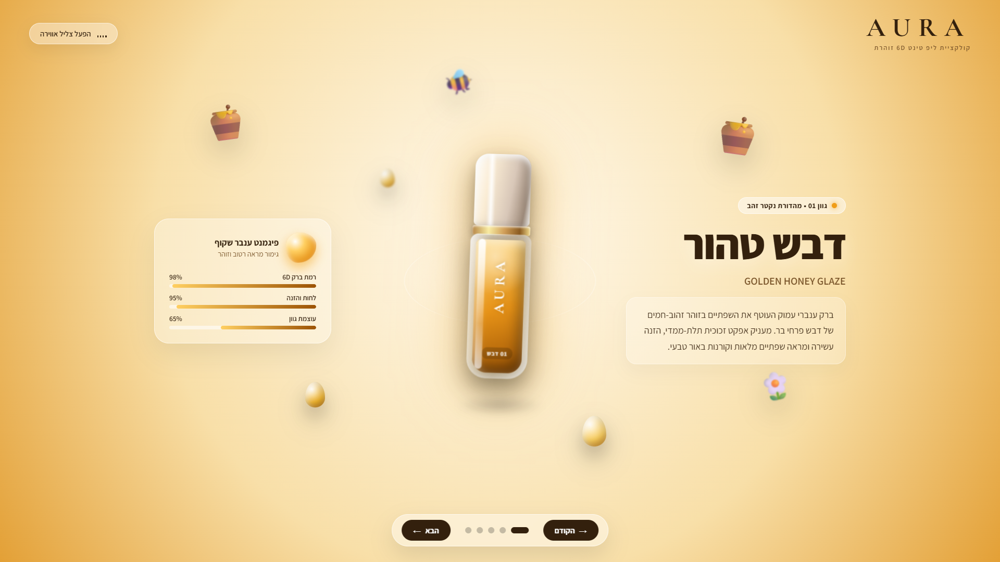
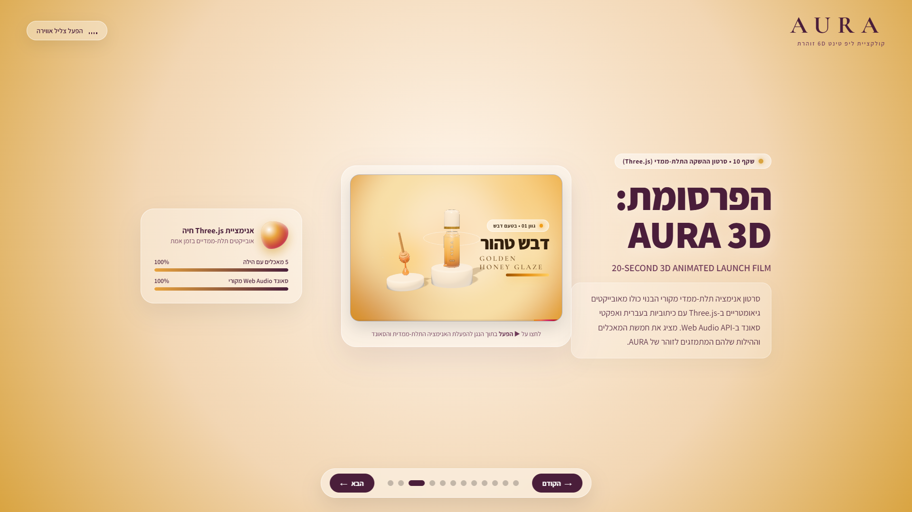
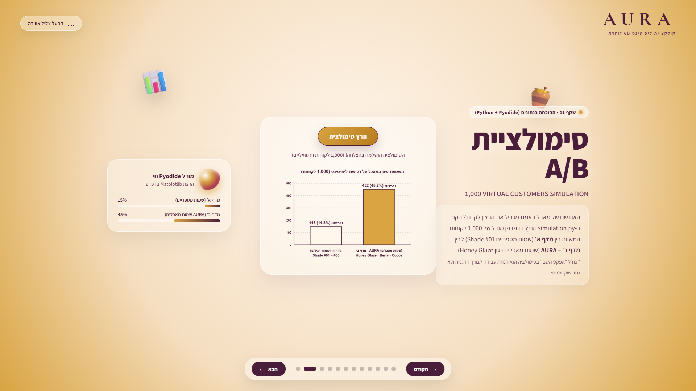
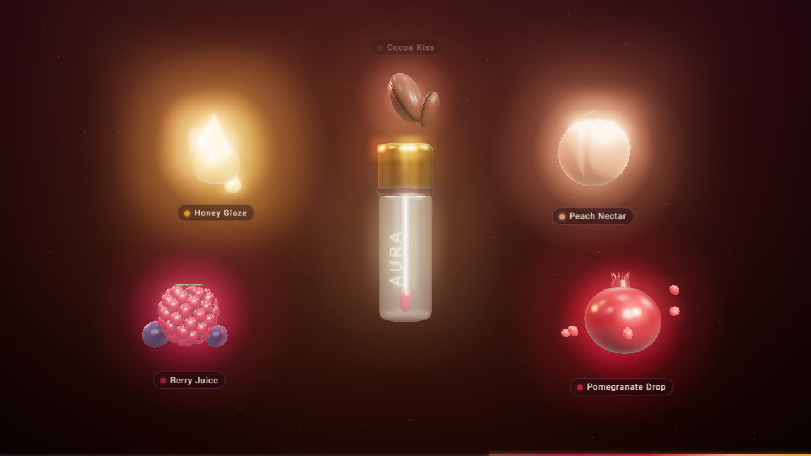
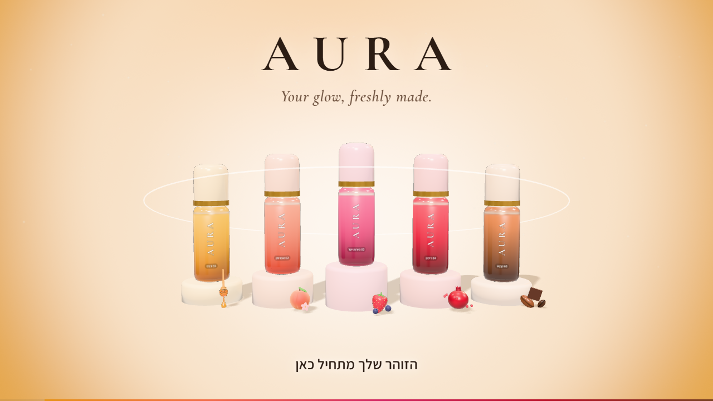

# ex01-marketing

## Final Submission

**Final files:**

| Deliverable | File |
| ----------- | ---- |
| Presentation (final deck) | [`src/deck-v4.html`](src/deck-v4.html) |
| 3D launch film | [`src/film-v3.html`](src/film-v3.html) |
| Python simulation | [`src/simulation.py`](src/simulation.py) |

**How to view:**

1. Download the repository (Code → Download ZIP) or clone it: `git clone https://github.com/daherraneem/ex01-marketing.git`
2. Open [`src/deck-v4.html`](src/deck-v4.html) in Chrome. The film is on Slide 10 and the Python simulation is on Slide 11.
3. An internet connection is needed: the Python simulation runs in the browser with Pyodide, which loads from the internet (so do the fonts and Three.js).
4. The film starts with the Play button (▶ הפעל). Turn the sound on.

Older versions (`deck-v1`–`v3`, `film-v1`, `film-v2`) are kept on purpose to show our development process.

---

**Course:** AI Agents & Vibe Coding
**University:** University of Haifa
**Assignment:** Exercise 1
**Team:** Raneem Daher & Raghad Rabah
**Status:** Film final (v3) · Deck final (v4)

## Project Structure

| Folder                | Purpose                                      |
| --------------------- | -------------------------------------------- |
| `prompts/`            | Prompts used with the AI agent, one per step |
| `src/`                | Source code                                  |
| `assets/screenshots/` | Screenshots for documentation                |
| `docs/`               | Project documentation                        |
| `PRD.md`              | Product Requirements Document (the plan)     |

## Progress Log

- **2026-11-01** – Project setup: created folder structure (`prompts/`, `src/`, `assets/screenshots/`, `docs/`), saved the setup prompt, and wrote the README intro.
- 2026-11-02 – Added team roles document (Raghad).
- **2026-11-02** – Wrote PRD v1 (`PRD.md`): goals, scope, IP rules, deliverables with acceptance criteria, file structure, work split, milestones; added concept brief to `docs/`; git-ignored the lecture summary PDF (Raneem).
- **2026-11-02** – Film v1 (`src/film-v1.html`): 20-second Three.js ad that follows the storyboard. It has the AURA tube, five foods with auras in their shade colors, Hebrew RTL captions, Web Audio sound effects and Play/Replay buttons. All visuals are built from 3D geometry. Prompt saved in `prompts/04-film-v1.md` (Raneem).
- **2026-11-03** – Film v2 (`src/film-v2.html`): 5 tubes, one per shade, each with its own food, and a more natural look. Updated the storyboard in `docs/concept-brief.md` to match. Not selected, because all tubes appear together; next version will give each shade its own moment. Prompt saved in `prompts/06-film-v2.md` (Raneem).
- **2026-11-03** – Film v3 (`src/film-v3.html`), **the final film**: 24 s, Raghad's five shades from the deck, each alone with its own food, the deck's colors and fonts, realistic glass and gold, and a Web Audio soundtrack with a signature per shade. Updated the shade names in `PRD.md` and `docs/concept-brief.md` to Raghad's names. Prompt saved in `prompts/07-film-v3.md` (Raneem).
- **2026-11-03** – Deck v1 → v3 (`src/deck-v3.html`) & Python simulation (`src/simulation.py`): built the Hebrew RTL presentation with 6D floating product slides and campaign slides, added the 1,000-customer A/B Python simulation running in the browser with Pyodide on Slide 11, and embedded the final 3D launch film (`src/film-v3.html`) on Slide 10 with audio and fullscreen support. Prompts saved in `prompts/11-python-simulation.md` and `prompts/09-embed-film-v3.md` (Raghad).
- **2026-11-03** – Deck v4 (`src/deck-v4.html`): updated Slide 7 by removing the content about Hailey Bieber and replacing it with a bridge slide ("מההשראה למותג שלנו") connecting Rhode's food-inspired marketing insight to our original brand, AURA. Prompt saved in `prompts/10-slide7-update.md` (Raghad).
- **2026-11-03** – Prepared the repo for submission: added the "Final Submission" section at the top of the README (final files, how to view), checked that the final deck (`src/deck-v4.html`) embeds `film-v3.html` on Slide 10 and runs the Python simulation on Slide 11, and tagged the commit `submission-ex01` (Raneem).
- **2026-11-03** – Final fixes: film length in `PRD.md` changed to 20–25 s (the final film is 24 s); renamed the duplicate prompt `06-python-simulation.md` to `11-python-simulation.md`; changed "Honey Glaze" to "Golden Honey Glaze" on Slide 11 of `src/deck-v4.html` and in `src/simulation.py` (Raneem).

## Film Versions

| Version | File | What it is | Why we changed it | Status |
| ------- | ---- | ---------- | ----------------- | ------ |
| v1 | `src/film-v1.html` | First version – one AURA tube; the auras of all the flavors flow into it and fill it with color. | – (starting point) | Replaced by v2 |
| v2 | `src/film-v2.html` | 5 tubes, each with its own flavor and food, and a more natural look (glossy materials, soft light and shadows, realistic cosmetic packaging). | To match our concept that every lip tint has its own flavor, like in Raghad's deck. | **Not selected** – all tubes appear together; we want each shade to have its own moment. |
| v3 | `src/film-v3.html` | Each shade alone with its own food (3.5 s per shade), Raghad's exact shades (names, colors, foods) and deck style (cream-peach background with aura circles, her fonts), a more realistic look (glass with reflections, soft shadows, gold collars, glossy foods) and a soundtrack with a musical signature for each shade. | So every lip tint gets its own moment, and the film and the deck look like one campaign. | **Selected – final version** |

## Deck Versions

| Version | File | What it is | Why we changed it | Status |
| ------- | ---- | ---------- | ----------------- | ------ |
| v1 | `src/deck-v1.html` | First presentation – 5 interactive 6D floating lip tint shade slides in Hebrew RTL with ambient audio and sensory specs. | – (starting point) | Replaced by v2 |
| v2 | `src/deck-v2.html` | Added the Rhode case study & AURA campaign strategy slides plus Slide 11 with the live Python A/B simulation (`src/simulation.py`) running in the browser via Pyodide. | To back our sensory marketing insight with a 1,000-customer simulation chart directly inside the deck, as required by the PRD. | Replaced by v3 |
| v3 | `src/deck-v3.html` | Moved the deck into `src/` alongside `film-v3.html` and embedded the final 3D launch film (`src/film-v3.html`) on Slide 10 using an `<iframe>` with `allow="autoplay; fullscreen"`. | Because the old relative path pointed to the wrong folder and lacked audio/fullscreen permissions; placing both files in `src/` makes the embedded 3D film play seamlessly inside Slide 10. | Replaced by v4 |
| v4 | `src/deck-v4.html` | Slide 7: removed the content about Hailey Bieber and replaced it with a bridge slide (from inspiration to our own brand). | Our project focuses on our original brand, AURA; Rhode is used only as inspiration. | **Selected – final version** |

## Screenshots

**Deck preview** – Slide 1 (Golden Honey Glaze) with 6D floating lip tint tube and Hebrew RTL layout:

**Deck Slide 10 (Embedded 3D Film)** – `src/film-v3.html` playing inside Slide 10 of `src/deck-v3.html`:

**Deck Slide 11 (Python Simulation)** – after clicking "הרץ סימולציה", showing the 1,000-customer A/B test chart (Shelf A numbered names vs. Shelf B AURA food names):

**Film v1** – the five foods, each with an aura in its shade color (at 8 s):

**Film v3 (final)** – the end card: all five shades with their foods, the AURA logo and the slogan (at 22.5 s):

